# FluidScope – GUI-Impressionen

Echte Aufnahmen von FluidScope 0.4.5 bis 0.4.9 mit synthetischen Audiosignalen. Die Bilder zeigen die tatsächliche Oberfläche; sie sind keine Design-Mockups.

## Vier Blicke auf denselben Klang

Wellenform, Lissajous, FFT und Zeitverlauf nebeneinander. Die Vollbildansicht lässt der Darstellung Raum.

## Wellenformen in Bewegung

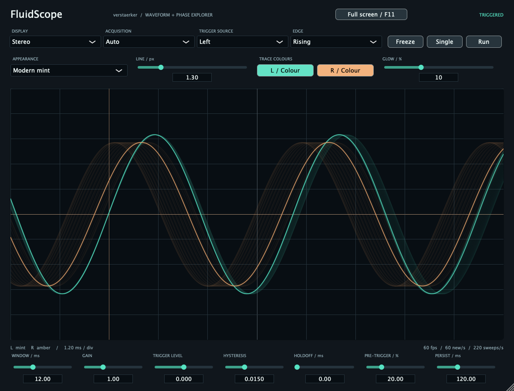

Zwei Kanäle, stabiles Triggering und einstellbares Nachleuchten, um Veränderungen zu verfolgen.

## Phase bekommt eine Form

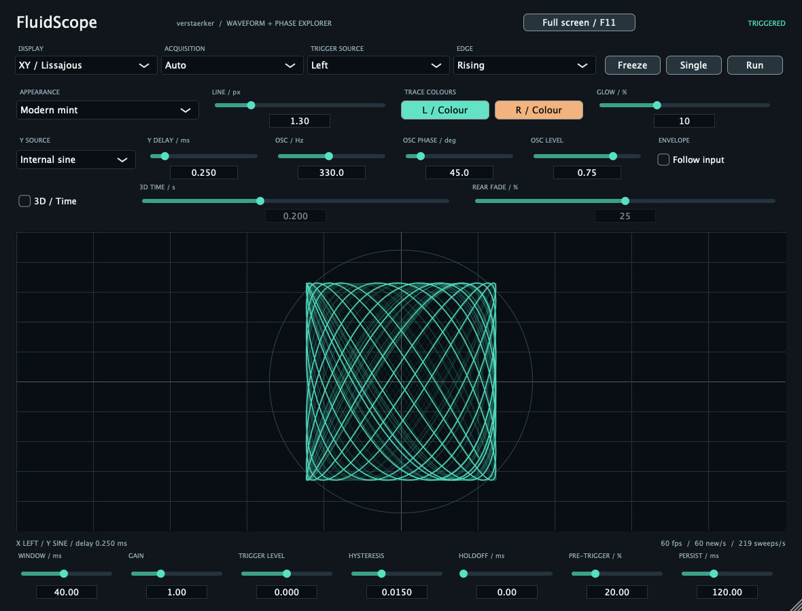

X und Y können zwei Eingänge, ein verzögertes Signal oder einen internen Sinus vergleichen.

## Lissajous mit Zeitachse

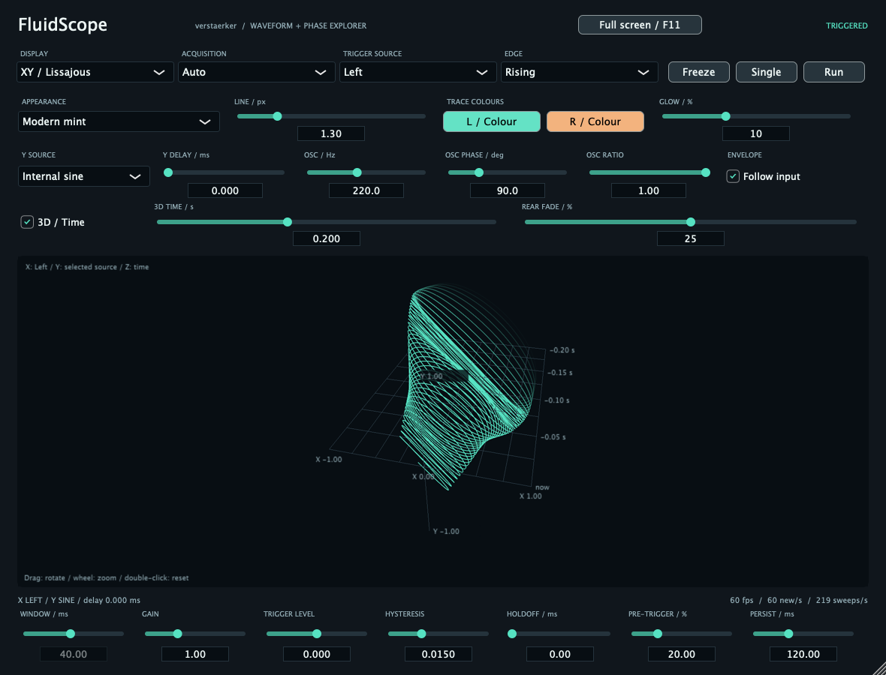

Die dritte Achse zeigt die Bewegung über die Zeit. Rotation, Zoom und weicher Rear Fade helfen beim Erkunden.

## Ein lesbarer Blick ins Spektrum

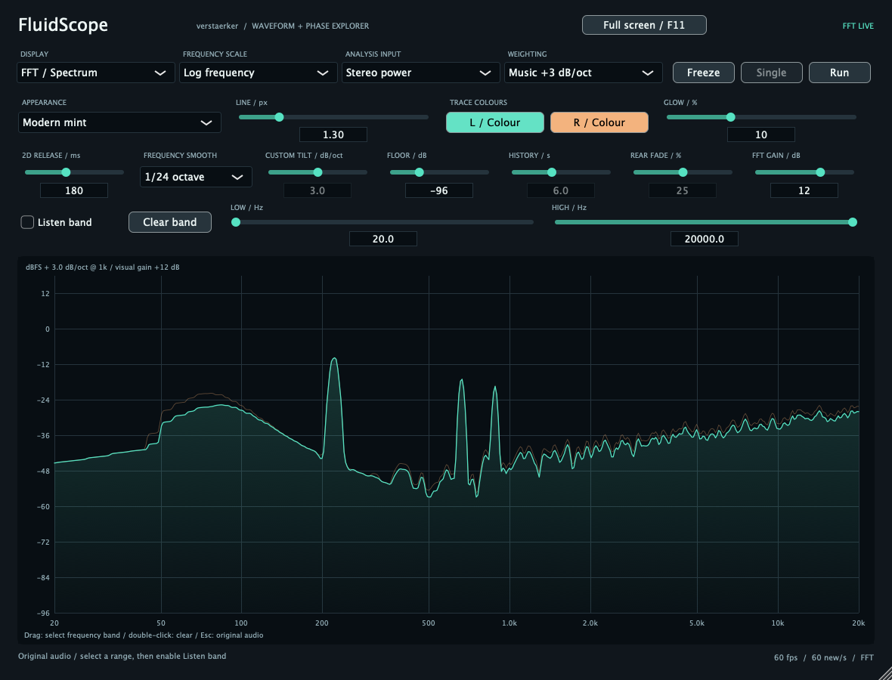

Gewichtung, Glättung und Anzeigepegel lassen sich an die Fragestellung anpassen. Sie verändern das Eingangsaudio nicht.

## Das Spektrum erinnert sich

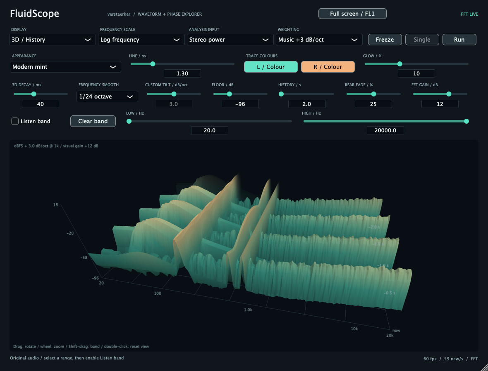

Ein räumlicher Verlauf macht sichtbar, wie sich das Spektrum entwickelt.

## Freie Perspektiven im Clean Mode (0.4.6)

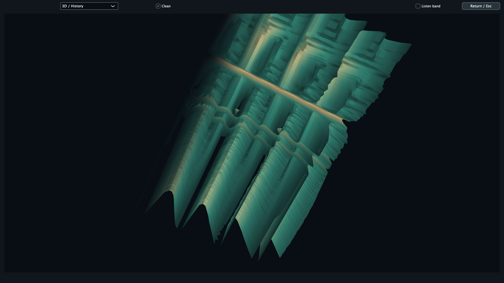

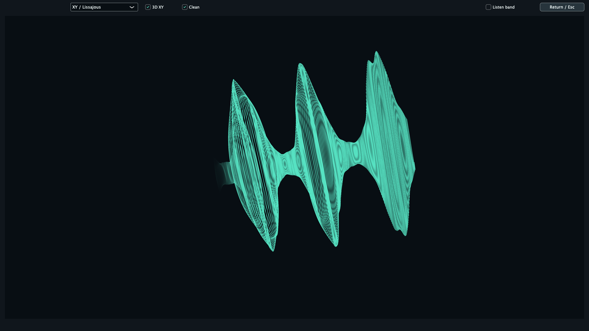

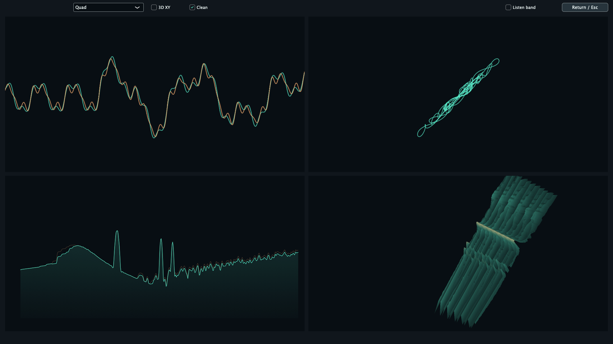

## Wireframe (0.4.7)

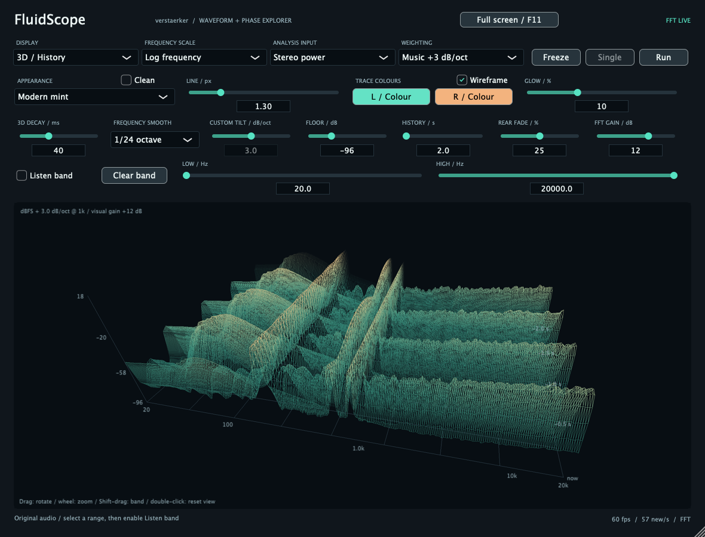

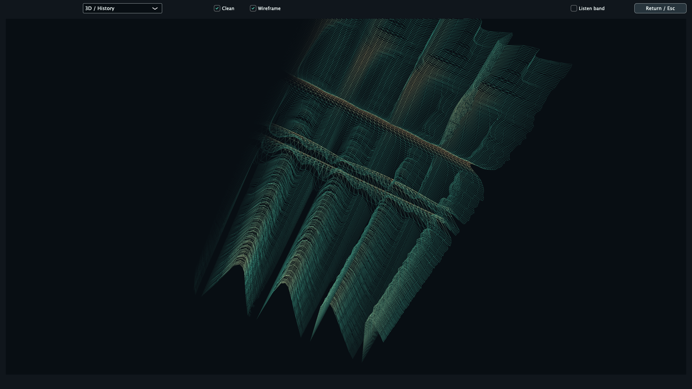

## App-Icon unter macOS (0.4.9)

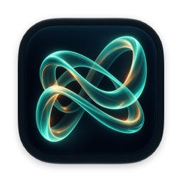

Von macOS/AppKit aus dem gebauten App-Bundle gerendert, ohne manuell zugewiesenes Finder-Icon. Das ursprüngliche Lissajous-Ribbon-PNG ist unverändert.
