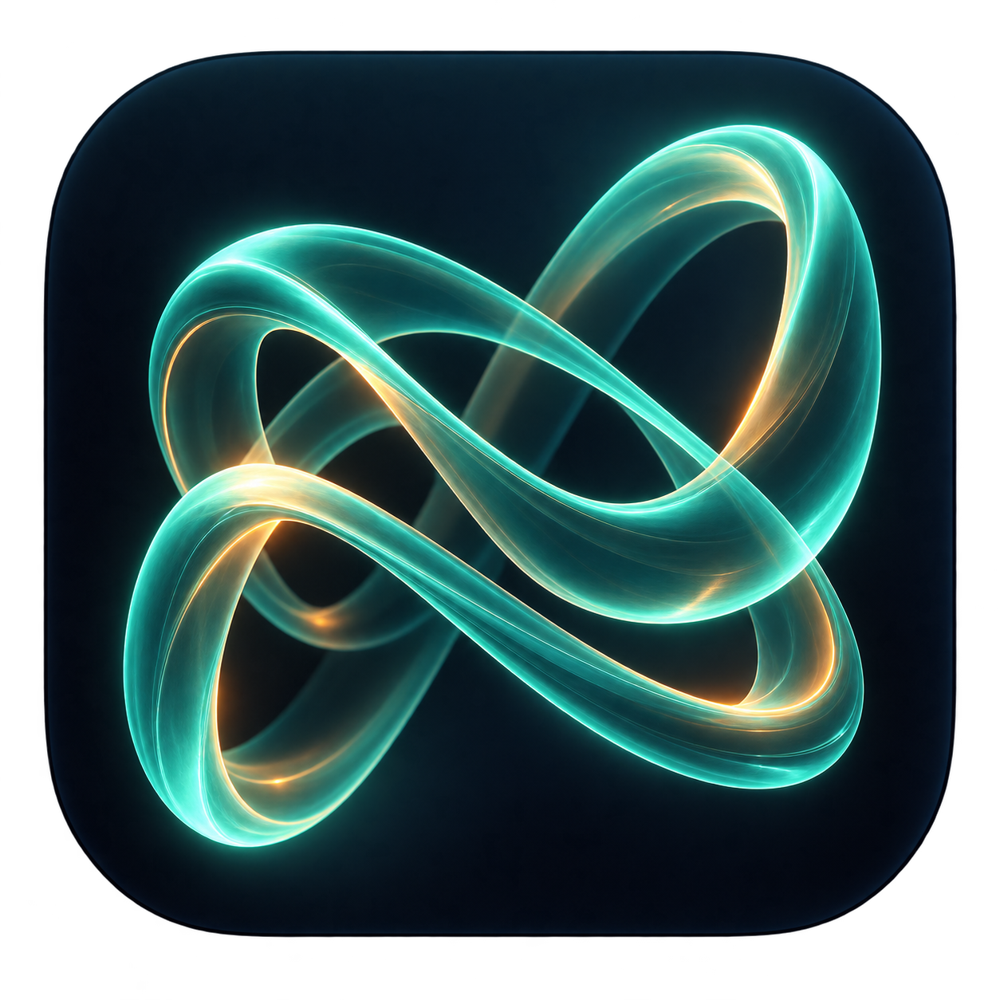
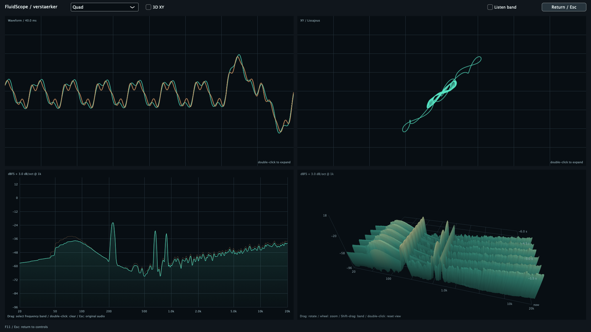

# FluidScope

### The oscilloscope I always wanted. Waveforms in motion.

An audio oscilloscope by **verstaerker**, built around fluid motion, stable triggering and a readable view into sound. Explore stereo waveforms, XY/Lissajous figures and spectra, then add time as a third dimension.

**macOS Apple Silicon + Intel · VST3 + standalone · 0.4.9 · GPLv3 or later**

[Deutsch](../README.md) · [Quick start](QUICKSTART.en.md) · [Gallery](GALLERY.md) · [Downloads](https://github.com/verstaerkermusic/FluidScope/releases)

## Made to follow the sound

I wanted a scope that makes movement easy to follow: modulated waveforms, transients, phase relationships and the way a spectrum changes over time. Something enjoyable to watch and useful to understand.

FluidScope brings five views together:

- **Stereo:** two traces, fractional-sample trigger alignment, hysteresis, holdoff, pre-trigger, Freeze, Single and phosphor persistence.
- **XY / Lissajous:** left against right, delayed left or an internal sine. Add time as a third axis. The sine can follow the left input's envelope.
- **FFT / Spectrum:** log/linear frequency scales, frequency smoothing, display weighting, peak trace and visual-only gain.
- **3D / History:** 2–12 seconds of spectral history, unrestricted horizontal and vertical orbit rotation, mouse-wheel zoom and a soft rear fade.
- **Quad:** waveform, XY, spectrum and 3D history together.

Select and audition a frequency band. Pick a classic green, amber or monochrome look, choose a modern palette, or set your own colours, line width and glow. Use full screen when you want the signal to fill the display.

**Wireframe** shows the 3D spectrum as a line mesh instead of a filled surface, including Quad and full screen.

**Clean mode** hides grids, scales, axes and plot hints in every view, including Quad and full screen. Controls stay accessible.

## Install

Download and extract the macOS Universal release. Copy `FluidScope.vst3` into `~/Library/Audio/Plug-Ins/VST3/`, then restart your DAW and rescan if needed. The manufacturer is **verstaerker**. To run without a DAW, copy and launch `FluidScope.app`.

Requires macOS 12+ on Apple Silicon or Intel. VST3 and standalone only; no AU or Windows build is included. 3D views require OpenGL 3.2+. Intel binaries were cross-built and regression-tested under Rosetta; native Intel hardware testing is still pending. Downloads are ad-hoc signed, not notarized, so macOS may request additional approval.

## Notes

Band audition applies steep filters and its enabled state is saved with the project. With audition off and its short transition complete, audio is unchanged. It isolates frequency ranges, not individual instruments or stems. The standalone app analyses device inputs; desktop playback requires a suitable loopback input.

Frame rate depends on the Mac, host, sample rate, time span, display size, zoom and signal. Dense figures and long histories remain more demanding. FFT analysis windows and smoothing introduce response time.

## Source

Licensed under **GPLv3 or later**. The repository and source archive include the exact JUCE 7.0.10 snapshot used by this release, including its documented macOS snapshot patch. See [build instructions](../BUILDING.md), [LICENSE](../LICENSE) and [NOTICE](../NOTICE.md).

Inspired by the Oscilloscope and XYScope concepts in [FigBug/slPlugins](https://github.com/FigBug/slPlugins). Original BSD notices are retained in [UPSTREAM-LICENSE.md](../UPSTREAM-LICENSE.md).
